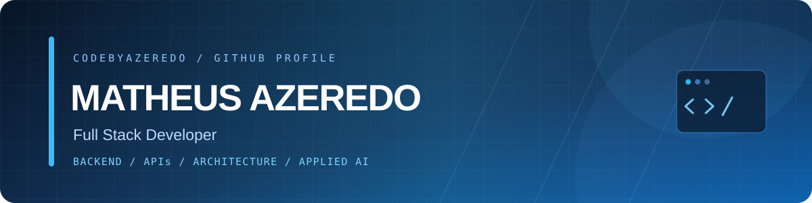

 

 

**English** · [Português](README.pt-BR.md)

## About

My primary focus is Backend Development, designing and building APIs, integrations, and business systems with clean, scalable, and reusable architectures. I also develop professional, intuitive, and functional user interfaces, always prioritizing the user experience.

I value well-structured, maintainable, and testable code, with a strong emphasis on clarity and long-term maintainability for other developers. I also work on AI-powered solutions, including LLMs, RAG, and intelligent agents, applying these technologies to real-world scenarios and workflows.

## Focus

| **Backend** | **Integrations** | **Quality** |
|:--|:--|:--|
| Domain logic, REST APIs and data models designed to be changed without fear. | Webhooks, third-party APIs and service-to-service communication that fail loudly and recover cleanly. | Clean Architecture, SOLID, TDD and refactoring of legacy code, one safe step at a time. |

## Stack

## AI in the workflow

- LLM integration and features driven by application context
- RAG, agents, tool calling and workflow orchestration
- Spec-Driven Development
- AI-assisted testing, code review and refactoring

## Activity

