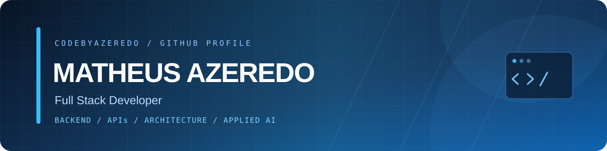

 

[English](README.md) · **Português**

 

## Perfil

Meu foco principal é o desenvolvimento Backend, projetando e construindo APIs, integrações e sistemas de negócio com arquiteturas limpas, escaláveis e reutilizáveis. Também desenvolvo interfaces profissionais, intuitivas e funcionais, sempre priorizando a experiência do usuário.

Valorizo código bem estruturado, manutenível e testável, com atenção à clareza e à facilidade de evolução por outros desenvolvedores. Também trabalho com desenvolvimento de soluções baseadas em IA, incluindo LLMs, RAG e agentes inteligentes, aplicados a cenários e fluxos de trabalho reais.

[**Ver o portfólio completo**](https://www.codebyazeredo.com.br/)

 

## Stack

 

Também no dia a dia: Laminas e React Native.

 

## Foco

**Backend.** Lógica de domínio, APIs REST e modelagem de dados feitas para mudar sem medo.

**Integrações.** Webhooks, APIs de terceiros e comunicação entre serviços que falham de forma clara e se recuperam bem.

**Qualidade.** Clean Architecture, SOLID, TDD e refatoração de legado, um passo seguro de cada vez.

 

## Atividade

 

## IA no fluxo de trabalho

- Integração com LLMs e recursos guiados pelo contexto da aplicação
- RAG, agentes, tool calling e orquestração de fluxos
- Spec-Driven Development
- Testes, code review e refatoração assistidos por IA

Ferramentas do dia a dia: **Claude Code** e **OpenAI Codex**.

 

